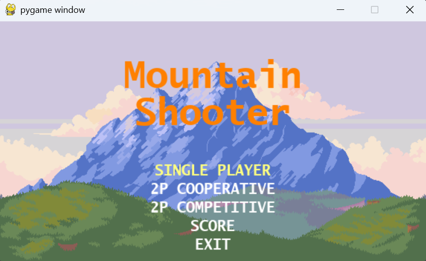
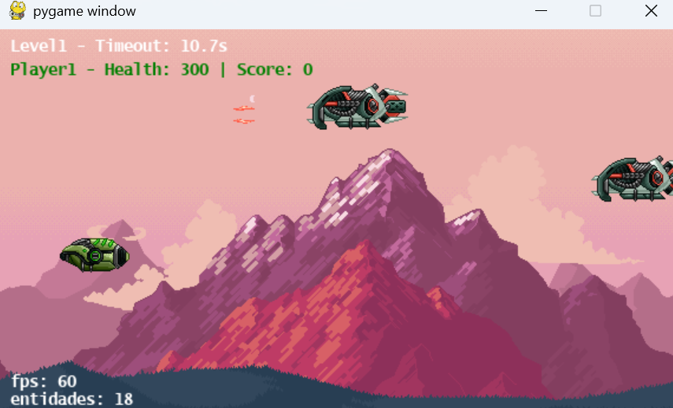

# Mountain Shooter

A small 2D side-scrolling shooter built with Python and Pygame for a college assignment. The game features local multiplayer modes, two stages with parallax backgrounds, simple enemy AI, shooting mechanics, music, and a Top 10 high-score table saved locally using SQLite.

## Preview

<p align="center">
  
  
</p>

### Features

- **Game modes**: Single Player, 2P Cooperative, 2P Competitive, Scoreboard, Exit
- **Two stages**: Progress from Level 1 to Level 2 if you survive the timer
- **Local multiplayer**: Supports two players on the same keyboard
- **Parallax backgrounds**: Multiple scrolling layers per level
- **Enemies and projectiles**: Two enemy types with different stats and shot patterns
- **Scoring system**:
  - Single Player: your score
  - Co-op: average of Player 1 and Player 2 scores
  - Competitive: highest score between the two players
- **High scores**: Save your score with a 4-character name; view Top 10 (SQLite database)

### Controls

- **Player 1**: Arrow keys to move, Right Ctrl to shoot
- **Player 2**: WASD to move, Left Ctrl to shoot

### Tech Stack

[](https://skillicons.dev)

## Getting Started

### Requirements

- Python 3.10+ recommended
- pip

### Install

```bash
pip install -r requirements.txt
```

### Run from source

```bash
python main.py
```

## Build (optional)

If you want a standalone executable, you can use PyInstaller. Examples below assume you're in the project root.

```bash
py -m pip install pyinstaller
py -m PyInstaller --name MountainShooter --onefile --noconsole --add-data "asset;asset" main.py
```

The built executable will be in `dist/MountainShooter.exe`.

## How the game works

- The game starts in the menu. Choose a mode to begin Level 1.
- Each level runs on a timer; if you survive until it hits zero, you advance (Level 1 → Level 2 → Score).
- Enemies spawn periodically and move left; players move and shoot to destroy them.
- Collisions apply damage and award score to the player whose projectile delivered the final hit.
- At the end, enter a 4-character name to save your score; view the Top 10 scoreboard.

## Acknowledgements

Assets and code are included for educational purposes.
